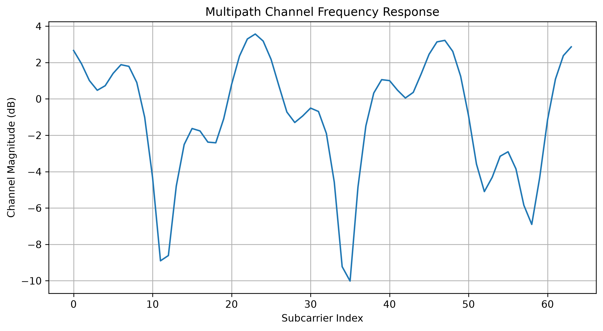
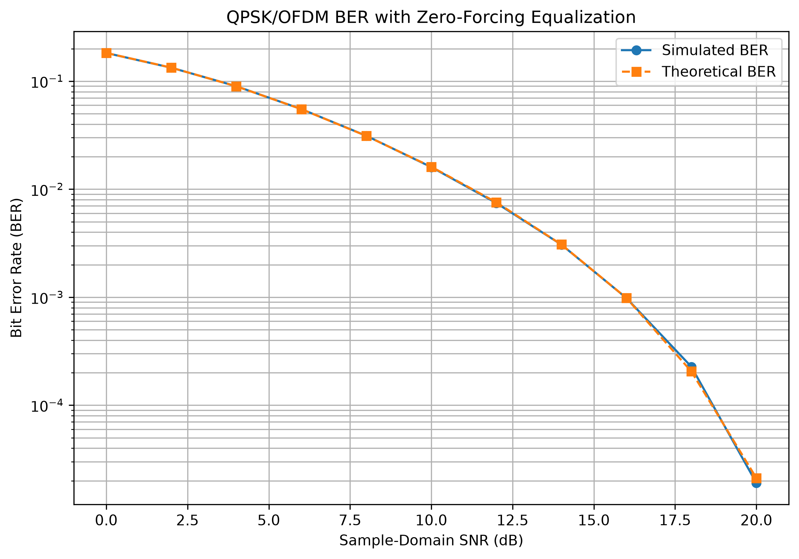
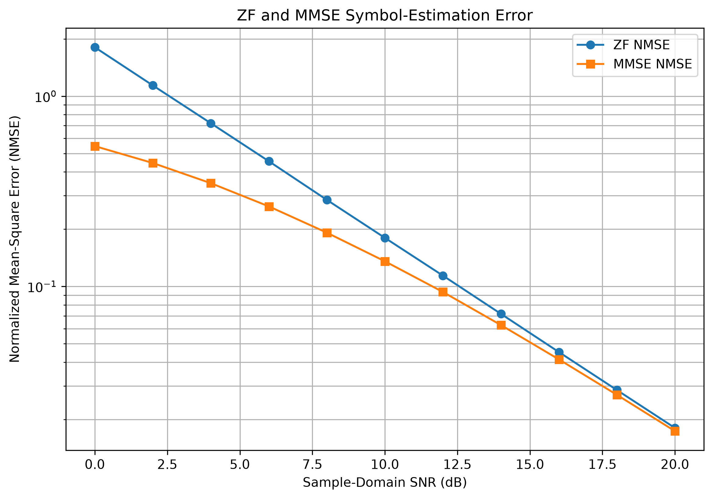
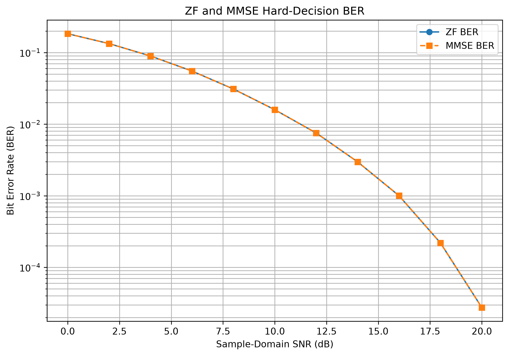
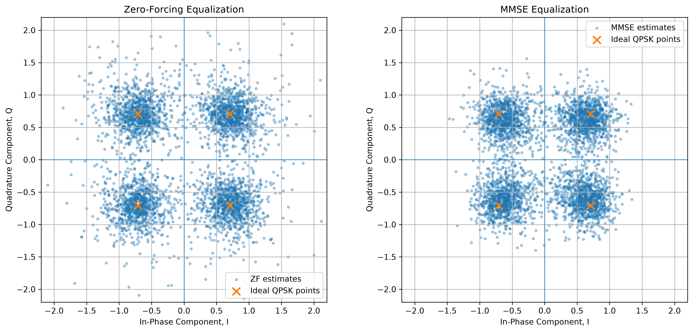

# OFDM Wireless Channel Modeling

A Python-based study of orthogonal frequency-division multiplexing (OFDM) over a frequency-selective multipath channel. The notebooks build a QPSK/OFDM transmitter and receiver, measure the effects of multipath and additive white Gaussian noise (AWGN), and compare zero-forcing (ZF) with minimum mean-square error (MMSE) equalization.

The project progresses from a preliminary RLC frequency-response experiment to a digital communication link with increasingly realistic channel impairments. The wireless-link simulations use a simplified complex-baseband model, with plots and numerical checks at each stage.

## Questions explored

- How do delayed signal paths change the amplitude and phase of OFDM subcarriers?
- Why does a cyclic prefix allow a sufficiently short multipath channel to be equalized in the frequency domain?
- How does bit error rate (BER) change as noise decreases?
- How do ZF and MMSE equalizers differ in symbol-estimation error, and why can they produce identical hard-decision QPSK bits?

## Simulation at a glance

| Parameter | Value |
| --- | --- |
| Modulation | Gray-coded QPSK (2 bits per symbol) |
| FFT/IFFT length | 64 samples |
| Cyclic prefix | 16 samples |
| Subcarrier allocation | All 64 FFT bins used for data (simplified model) |
| Multipath delays | 0, 3, and 8 samples |
| Channel model | Three complex taps, normalized to unit total energy |
| Receiver equalizers | Zero-forcing and linear MMSE |
| Noise | Complex AWGN added in the time domain |
| Channel information | Perfectly known at the receiver |
| Performance metrics | BER and normalized mean-square symbol-estimation error (NMSE) |

The primary BER sweeps use **sample-domain SNR**, defined from the average received complex-sample power and the injected time-domain noise power. This is not labeled as \(E_b/N_0\), since the definitions differ when OFDM overhead is included.

## Notebooks

Run the notebooks in numbered order. Each notebook develops a self-contained experiment and saves plots in [`results/`](results/).

| Notebook | Experiment |
| --- | --- |
| [`01_rlc_frequency_response.ipynb`](notebooks/01_rlc_frequency_response.ipynb) | Numerical RLC-system modeling and frequency-response analysis; an introductory physical-systems experiment. |
| [`02_qpsk_ofdm_basics.ipynb`](notebooks/02_qpsk_ofdm_basics.ipynb) | QPSK mapping, OFDM modulation and demodulation, FFT/IFFT operations, cyclic prefix, and ideal-link verification. |
| [`03_multipath_channel_equalization.ipynb`](notebooks/03_multipath_channel_equalization.ipynb) | Three-path frequency-selective channel, impulse and frequency responses, received constellation distortion, and noiseless ZF equalization. |
| [`04_awgn_ber_performance.ipynb`](notebooks/04_awgn_ber_performance.ipynb) | Complex AWGN, receiver validation, and Monte Carlo BER-versus-SNR measurements compared with a channel-aware analytical prediction. |
| [`05_zf_mmse_equalization.ipynb`](notebooks/05_zf_mmse_equalization.ipynb) | ZF versus MMSE using paired noise realizations; constellation, NMSE, and hard-decision BER comparisons across SNR. |

## Signal model

The transmitted bits are mapped to unit-energy QPSK symbols and grouped into 64-subcarrier OFDM blocks. An IFFT converts each block to the time domain, and a 16-sample cyclic prefix is prepended before transmission.

The channel impulse response has a direct path and two delayed reflections:

$$
h[\ell] = h_0\delta[\ell] + h_3\delta[\ell-3] + h_8\delta[\ell-8].
$$

The coefficients are complex, so the reflections introduce both attenuation and phase shifts. Because the channel's maximum delay is 8 samples and the cyclic prefix is 16 samples long, the receiver can remove the prefix and model the useful OFDM samples as circular convolution. After the FFT, each subcarrier follows

$$
Y[k] = H[k]X[k] + W[k],
$$

where \(X[k]\) is the transmitted symbol, \(H[k]\) is the channel frequency response, and \(W[k]\) is transformed additive noise.

The equalizers are

$$
G_{\mathrm{ZF}}[k] = \frac{1}{H[k]},
\qquad
G_{\mathrm{MMSE}}[k] = \frac{H^*[k]}{|H[k]|^2 + \sigma_W^2/E_s}.
$$

Here \(E_s\) is average QPSK-symbol energy and \(\sigma_W^2\) is the frequency-domain noise variance. The simulations use NumPy's FFT convention when converting time-domain noise power to frequency-domain variance.

## Selected results

### Frequency-selective fading and equalization

The multipath model has channel-magnitude variation across the 64 subcarriers. In the noiseless experiment, the received QPSK constellation is distorted before equalization and returns to the four ideal decision points after ZF equalization, to numerical floating-point precision.



### BER under additive noise

The simulated QPSK/OFDM BER falls with increasing sample-domain SNR and closely follows the channel-aware analytical reference in the AWGN experiment. This provides a check on the transmitter, receiver, noise generation, equalizer, and BER calculation.



### ZF versus MMSE

ZF removes the known channel response directly but can amplify noise on weak subcarriers. MMSE balances channel inversion against noise amplification. In the 10 dB comparison shown in Notebook 05, the normalized MSE is approximately **0.180 for ZF** and **0.135 for MMSE**, a reduction of about **25%**.



Under the experiment's assumptions (perfect channel knowledge, conventional QPSK hard decisions, and a real, positive MMSE scaling of the ZF estimate), both equalizers yield **identical detected bits**, even though their symbol-estimation MSE values differ. This is a property of the specified model and detector, not a claim that the two methods always have identical BER in practical receivers.



The saved constellation comparison provides another visual view of the different symbol estimates:



## Run locally

The repository contains a [`requirements.txt`](requirements.txt) file for the Python environment. Use Python 3 with a working `venv` installation.

```bash
# Clone the public GitHub repository
git clone https://github.com/rvincent22/ofdm-wireless-channel-model.git
cd ofdm-wireless-channel-model

# Create and activate a virtual environment on Windows / Git Bash
py -3 -m venv .venv
source .venv/Scripts/activate

# Install the project's declared dependencies
python -m pip install --upgrade pip
python -m pip install -r requirements.txt

# Start JupyterLab
jupyter lab
```

In JupyterLab, open the files in `notebooks/` and run each one from the top with **Kernel > Restart Kernel and Run All Cells**. The plotting code writes to `../results/` relative to the notebook working directory; run the notebooks with their working directory set to `notebooks/` so those paths resolve correctly.

The notebooks use fixed random-number seeds for repeatable simulations. **All five notebooks were successfully executed cell by cell in sequence using a separate, freshly created Python environment with the declared dependencies installed. The numerical checks passed, and the expected plots were generated. This validation used direct Python cell execution rather than Jupyter's notebook execution client.**

## Repository layout

```text
ofdm-wireless-channel-model/
├── notebooks/       # Five numbered Jupyter notebooks
├── results/         # Saved plots generated by the notebooks
├── experiments/     # Reserved project directory
├── src/             # Reserved for reusable implementations
├── theory/          # Reserved for supporting notes
├── README.md
├── requirements.txt
└── .gitignore
```

The `src/`, `theory/`, and `experiments/` directories are not required for the notebook demonstrations unless code or files are later added to them.

## Scope and limitations

This is a **simulation of a complex-baseband wireless link**. It does not transmit RF signals or implement the complete Wi-Fi or cellular physical layer. In particular:

- All 64 FFT bins are data-bearing; practical systems reserve bins for pilots, guards, and other functions.
- The channel is a fixed, three-tap discrete-time model, rather than a measured or time-varying propagation channel.
- The receiver is synchronized and is given the exact channel response; it does not yet estimate the channel from pilots.
- The model does not include forward-error-correction coding, timing/frequency-offset impairment, Doppler, or hardware nonidealities.
- Monte Carlo BER measurements depend on finite trial counts; extremely low BER values require more transmitted bits to estimate reliably.

Possible extensions include pilot-assisted channel estimation, imperfect channel knowledge, alternative delay profiles, active-subcarrier allocation, and coded transmission. These are **future work**, not features of the current notebooks.

## Project status

The five planned modeling notebooks are complete. The project includes multipath channel modeling, QPSK/OFDM transmission and reception, AWGN performance analysis, and ZF/MMSE equalizer comparisons.
All five notebooks passed sequential code-cell execution in a separate clean Python environment. Their numerical validations passed, and the expected result figures were generated.
The repository includes pinned project dependencies, documented assumptions and limitations, reproducible random seeds, and saved simulation figures.
The core project is complete. Additional features described under Scope and limitations remain optional future work.
